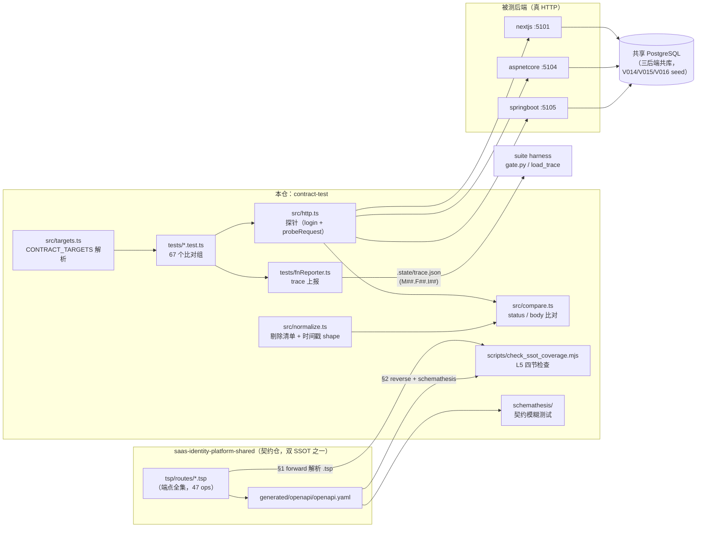
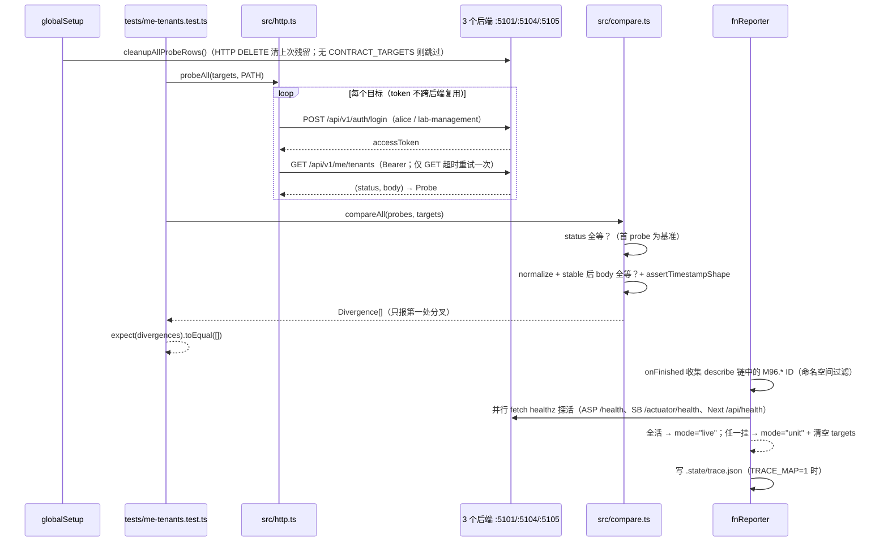

# saas-identity-platform-contract-test 架构

> 一句话定位：saas-identity-platform 家族第 6 角色仓（ADR-0015）——黑盒 HTTP 逐个打后端，
> 验证多个独立实现「对前端不可区分」；保留命名空间 `M96`，不镜像 BASE 业务模块。

生成日期：2026-09-22 ｜ 锚定 HEAD：932d7e1 ｜ 生成方式：DeepWiki 风格架构扫描

## 1. 总览

- **定位与职责**：家族 6 角色中的 **contract-test**。同一份 shared 契约由多后端
  （nextjs / aspnetcore / springboot）各自实现，本仓对每个实现发同样的 HTTP 请求，
  断言「同输出」——它回答「哪里不一致」，后端自己的单测回答「为什么」。
  不是后端单测搬家（各后端测的层不同），也不是 E2E（不开浏览器）。
- **技术栈**：TypeScript（ESM）+ vitest ^2.1 + axios ^1.19 + tough-cookie +
  axios-cookiejar-support；Node >= 20。另有 Python 侧 schemathesis 4.x 契约模糊测试
  （`schemathesis/run.py`，非 npm 依赖）。
- **「同输出」的语义（CLAUDE.md 铁律）**：不是逐字节相同（UUID/时间戳/token 天生不同），
  判定 = **status 全等 + schema 校验 + `normalize()` 后全等**。
  `normalize` 的剔除清单本身是契约——它显式声明「前端不许依赖这些字段」。
- **规模速览**（真实文件统计）：
  - `src/` 9 个 TS 模块（约 830 行），`tests/` 16 个端点套件 + 2 个纯单测 + fnReporter/globalSetup（约 3600 行）
  - shared SSOT 端点全集 **47 个**（`../saas-identity-platform-shared/tsp/routes/*.tsp` 的 op 计数）
  - `tests/` 内 `describe.skipIf` 比对组 **67 个**；msw（:5100）已于 5.81 退役，现打 3 个真后端
  - `scripts/check_ssot_coverage.mjs` 757 行（L5 四节检查）

## 2. 系统架构

关键边界解读：

1. 本仓**不直接消费 openapi.yaml 做断言**——vitest 断言是手写的（必填字段清单来自契约注释）；
   openapi.yaml 只被 schemathesis 与 L5 §2 reverse 消费，SSOT forward 直接解析 `.tsp` 源文件。
2. 三后端**共享同一个 PG**，所以 normalize 默认不剔 ID（UUID 本该相等，剔了丢信号）；
   只有比对集合含内存型后端（msw，已退役）时才传 `ID_KEYS`。
3. `fnReporter` 是本仓对 suite harness 的**唯一出口**：把测试名里的功能 ID 写进
   `.state/trace.json`，供 `require_live` 门与 L5 引用检查。
4. seed 数据不是本仓私产：`src/seed.ts` 是 shared V016 SQL 与 msw fixtures 的**镜像**，三方必须逐字一致。

## 3. 模块分解

| 模块/目录 | 职责 | 关键文件 |
|---|---|---|
| 归一化 | 「同输出」核心：剔 ALWAYS_VOLATILE（token/jti）+ TIMESTAMP_KEYS；key 排序、数组排序、null≡缺失、随机测试 tag 抹平；独立 `assertTimestampShape`（ISO 8601 + 年份 ∈ [1970,2100]） | `src/normalize.ts` |
| 比对引擎 | 同请求打 N 后端，以第一个 probe 为基准（5.81 起 msw oracle 退役，三方互为对照）；status 全等 + `stable()` 后全等；只报第一处差异 | `src/compare.ts` |
| 目标声明 | `TARGETS` 端口表（conventions §6 显式字面量，禁 env 兜底）；`selectedTargets()` 解析 `CONTRACT_TARGETS`，未设=空（只跑单测），名字不认识=抛错 | `src/targets.ts` |
| HTTP 探针 | axios + tough-cookie jar（HTTP 层，绕开 fetch 屏蔽 HttpOnly 的限制）；`maxRedirects:0` 手走 OAuth 302 链；timeout 30s；GET 超时重试一次（POST/PATCH 绝不重试）；`SEED_USER` 显式字面量 | `src/http.ts` |
| 测试支撑 | seed UUID 镜像（`seed.ts`）、路径参数 fail-fast 替换（`path.ts`）、写端点唯一名（`unique.ts`，`performance.now()` 微秒 + 随机防同毫秒撞唯一约束）、teardown 注册表 child→parent 顺序（`teardown.ts`）、进程级 PG 探针清库走 HTTP DELETE 不直连（`cleanup-pg.ts`） | `src/{seed,path,unique,teardown,cleanup-pg}.ts` |
| 端点套件 | 每端点一个文件：beforeAll `probeAll` → status/schema/required 字段/normalize 全等四段断言；写测试用 `uniqueName` + teardown | `tests/*.test.ts`（16 个） |
| trace 上报 | vitest 自定义 reporter：describe 链累积 ID → 命名空间过滤（`docs/functions/function-tree.md`）→ healthz 探活定 mode → 写 `.state/trace.json`（schema 1 + mode + contract_targets） | `tests/fnReporter.ts` |
| 生命周期 | globalSetup：仅 `CONTRACT_TARGETS` 存在时清上次残留探针行（ADR-0018，进程级一次） | `tests/globalSetup.ts` |
| L5 覆盖检查 | 四节：§1 forward（.tsp ↔ tests 标题 diff）；§2 reverse（三后端路由源码 ↔ openapi.yaml，抓私生端点）；§3 marker（五消费仓 `last-gen-shared.json` 的 api_synced_sha ↔ shared HEAD）；§4 sdk-warn（前端手写 axios 实例/路由表，WARN 不 FAIL） | `scripts/check_ssot_coverage.mjs` |
| 模糊测试 | schemathesis 4.x 全 method 模糊；`hooks.py` 按契约 `x-fuzz: skip` 扩展跳过；`config.toml` 关内置检查只留三个一致性检查（not_a_server_error 常开） | `schemathesis/{run.py,hooks.py,config.toml}` |
| 本机编排 | 一键起 3 后端 + healthcheck + live vitest + gate，模拟 ci.yml 核心步骤；终验脚本 `run-4way-final.sh` | `scripts/start-family.sh`、`run-4way-final.sh` |

注：原 `package.json` 的 `gen:shared`/`build` 脚本指向不存在的 `scripts/gen-shared.ts`（遗留死入口），
已于 2026-09-22 移除——本仓黑盒直读 shared `openapi.yaml`，不经 codegen。

## 4. 数据流 / 请求生命周期

一轮黑盒校验（以只读端点 `GET /api/v1/me/tenants` 为例）：

要点：

- `describe.skipIf(!live)`（live = `CONTRACT_TARGETS` ≥ 2 个目标）——未声明 env 时整组不跑，
  fnReporter 记为 inert；**声明了却连不上 = 红，不是 skip**（`UnreachableError`）。
- live 档下 vitest config 会 exclude `tests/unit/**`（纯单测在 live 结构性不成立，
  且 require_live 仓的 skip=0 硬门不容 inert 条目，见 `vitest.config.ts` 顶部注释）。
- `fileParallelism: false` 全量串行：三后端共库，写测试与读比对并行会互踩（约 3-4 分钟换确定性）。

## 5. 依赖面

- **对 shared 契约仓**（`../saas-identity-platform-shared`，相对路径兄弟仓）：
  - `.tsp` 端点全集——L5 §1 的比对基准（CLAUDE.md：本仓端点清单 = SSOT 全集，auto-derive，禁止手挑）
  - `generated/openapi/openapi.yaml`——schemathesis 的输入 + L5 §2 reverse 基准
  - `sql/migrations/V016__seed_family_fixtures.sql`——`src/seed.ts` 的唯一真源（镜像须逐字一致）
- **对家族其他仓**：
  - 被测对象：`saas-identity-platform-{nextjs,aspnetcore,springboot}`（L5 §2 直接扫它们的路由源码，§3 读它们 `.state/last-gen-shared.json` marker）
  - 端口：5101 / 5104 / 5105（`src/targets.ts` 硬编码字面量；msw :5100 已退役）
  - token 不互认：每个后端各自 login，accessToken 不跨后端复用
  - 前端仓（react/vue）只被 L5 §4 sdk-warn 扫描（WARN 级），本仓不发请求给它们
- **外部依赖**：共享 PostgreSQL（三后端共库，本机/CI 走远程节点）；本仓自身**不连 PG**
  （清库也走 HTTP DELETE，守住黑盒契约，ADR-0018）；无 IdP 直连（OAuth 流经后端 HTTP 面）。
- **dev/CI**：`.github/workflows/ci.yml`——起 3 后端 → 串行 healthcheck 90s（路径与
  `fnReporter.ts` 的 `HEALTH_PATHS` 互为镜像，改一处必须同步另一处）→ `npx --no vitest run` → 独立 step `tsc --noEmit`。

## 6. 配置与部署

| env key | 用途 | 缺失时的行为 |
|---|---|---|
| `CONTRACT_TARGETS` | 逗号分隔要打的目标（如 `aspnetcore,springboot,nextjs`） | 空 → 只跑纯单测（`selectedTargets()` 返回 `[]`，live 组 inert / unit 档被 exclude）；设了但不认识的名字 → **抛 `TargetError`**（不静默忽略） |
| `TRACE_MAP` | `1` 时 fnReporter 写 `.state/trace.json` | 未设 → reporter 只跑测试不落 trace |

- **无默认值兜底**是本仓硬规则（suite 2026-08-28 漂移事故）：端口、SEED_USER
  （alice / dev123456 / clientId=lab-management）、seed UUID 全部显式字面量。
- **部署方式**：本仓无 Dockerfile、无部署产物（待补充——仓内未见 deploy 脚本）。
  执行面三种：① suite 门禁 `python scripts/gate.py -p saas-identity-platform-contract-test`；
  ② 本机 live `bash scripts/start-family.sh`；③ CI `.github/workflows/ci.yml`。
- 测试产物落 `.state/trace.json` 与 `schemathesis-report/`；均为 gitignore 的运行时状态。

## 7. 质量门禁

来自 `.harness/stack.json`（`require_live: true`，stack `shared-typescript`）：

| 门 | 名称 | 命令 | 红了怎么修 |
|---|---|---|---|
| L3 | 类型 | `npx --no tsc --noEmit` | 补全类型 |
| L4 | 测试 | `npx --no vitest run` | 先让测试变绿；四方比对需 `CONTRACT_TARGETS` + 对应后端在跑 |
| L2 | SSOT 覆盖 | `node scripts/check_ssot_coverage.mjs` | shared SSOT 有端点但没测试 = 红；在 `tests/` 加 `*.test.ts` 接进来 |

- `trace_cmd`: `npx --no vitest run`，`trace_env`: `TRACE_MAP=1` +
  `CONTRACT_TARGETS=aspnetcore,springboot,nextjs`（缺 export 会复用旧 unit trace → require_live 必错）。
- exit code 语义：**0** = 完成；**1** = 按修复提示回代码；**2** = 契约/环境问题，停下问人。
- 铁律约束（CLAUDE.md §2）：msw（在位时）是 oracle，打它必须绿；不给未真正运行的比对挂
  功能 ID；写操作唯一化前缀 + teardown；改端点必先改 shared `.tsp` 再 regen，禁止声明 SSOT 之外
  的端点；`normalize` 剔除清单增删走 ADR。
